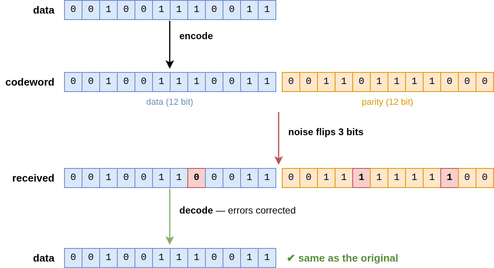

# Golay Code implementation

An implementation of the extended binary Golay code (24, 12).
It encodes 12-bit data into a 24-bit codeword, which can correct up to 3-bit errors and detect 4-bit errors.



## Example of use

Cargo.toml

```toml
[dependencies]
golay-code = "0.1"
```

src/main.rs

```rust
fn main() {
    let data: u16 = 0b0010_0111_0011;  // original data (12 bits)
    let tx: u32 = golay_code::encode(data);  // encode into a 24-bit codeword

    let e  = 0b0000_0001_0000_0000_1000_0100;  // 3-bit error
    let rx = tx ^ e;  // received word with some bits flipped

    // error detection & correction (when you need the corrected codeword)
    let corrected: Option<u32> = golay_code::ecc(rx);
    assert_eq!(Some(tx), corrected);

    // correct errors and extract the 12-bit data
    assert_eq!(Some(data), golay_code::decode(rx));
}
```
